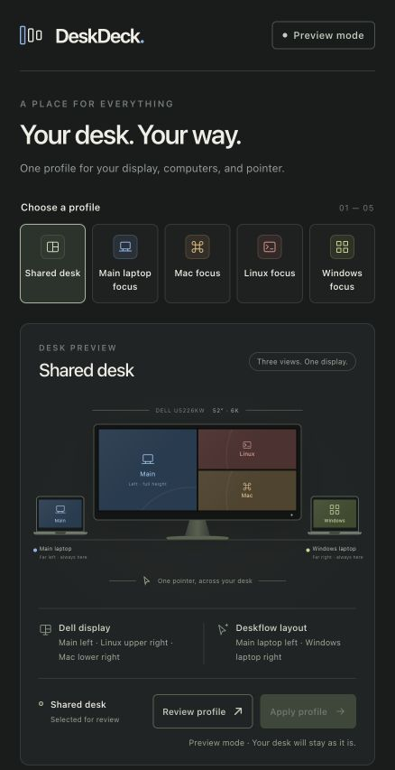

# DeskDeck

**Your desk modes. One place to remember them.**

A small local control-panel foundation for desks with a shared Dell
monitor, several computers, and Deskflow. The first target is the Dell UltraSharp
52-inch 6K U5226KW.

> **0.1 is a working preview, not a hardware-control release.** You can explore six
> complete profiles, inspect their restoration plans, and export draft Deskflow
> routes. It does **not** change your monitor, start Deskflow, flash firmware, or
> claim that your hardware has been tested. See [hardware findings](docs/HARDWARE.md).



## Why

Turning Picture-by-Picture off and back on should not mean rebuilding a whole desk.
DeskDeck models the *entire desired layout*: the split arrangement, every source
assignment, visible display geometry, and input routing. Returning to Shared always
produces the same full-state plan, independent of the monitor's remembered state.

Both laptop screens stay at the outside edges:

| Profile | Left laptop | Dell | Right laptop |
| --- | --- | --- | --- |
| Shared desk | Main | Main left; Linux upper right; Mac lower right | Windows |
| Four-way desk | Main | Mac upper left; Linux upper right; Main lower left; Windows lower right | Windows |
| Main laptop focus | Main | Main, full screen | Windows |
| Mac focus | Main | Mac, full screen | Windows |
| Linux focus | Main | Linux, full screen | Windows |
| Windows focus | Main | Windows, full screen | Windows |

These are logical positions, not a claim that a computer's individual monitors can
already be routed independently by Deskflow. Its current layout operates on
computer desktops; actual display bounds and edge segments need calibration.

## Try it

Python 3.12 or newer; no third-party runtime packages. Run from this checkout:

```sh
python -m deskdeck serve
```

On Windows, use `py -3 -m deskdeck serve` if your Python launcher is `py`.
Open **http://127.0.0.1:8765**. Stop with Ctrl+C. This release listens only on
loopback and does not install a service or change system settings.

```sh
python -m deskdeck profiles
python -m deskdeck plan shared
python -m deskdeck plan shared --setup examples/desk-setup.json
python -m deskdeck deskflow-draft focus-mac
python -m unittest discover -s tests -v
```

An installable entry point is also available with `python -m pip install .`.

### Menu bar and system tray

An optional launcher keeps DeskDeck in the macOS menu bar, Windows notification
area, or a compatible Linux tray. The browser panel itself needs no third-party
runtime packages. Install the extra in your own virtual environment:

```sh
python -m pip install '.[tray]'
deskdeck-tray --setup .local/desk.json
```

The menu offers **Open DeskDeck**, six **Preview** profiles, and **Quit DeskDeck**.
Selecting a preview does not apply it. Quit closes the launcher's own local
server. `--no-open` starts just the tray; `--port 0` selects a free local port.
No automatic startup is registered. Linux requires a menu-capable
AppIndicator/Ayatana or GTK backend; GNOME may require an indicator extension.
Native platform acceptance is separate from the mocked menu/lifecycle tests.

To include planned wiring in the panel, copy `examples/desk-setup.json` to an
ignored `.local/desk.json`, adjust the ports, and run:

```sh
python -m deskdeck serve --setup .local/desk.json
```

The setup explicitly maps each computer to a physical input. Reserved inputs are
shown separately and never create active profiles or routes. The example reserves
DP2 for a future computer. A loaded file is a user plan, not connected-device or
readback evidence; Apply stays disabled. `keyboard_owner` selects the default
server for Shared and Four-way modes; fullscreen plans select the focused computer.
For a receiver attached to the monitor, `usb_upstreams` maps each computer's USB
data cable separately from its video input. A coordinated role handoff and trusted
client connections must be qualified before input control is enabled. Files load only when
explicitly passed; invalid, duplicate or unknown assignments are rejected.

## What is implemented

- A responsive local control panel with six selectable desk previews.
- A full-state profile planner: selecting a focus mode cannot overwrite Shared.
- Draft Deskflow computer-edge configurations, with screen-name validation.
- Optional local planned-wiring files, with a port legend and per-region plans.
- An optional tray/menu-bar launcher with fixed local profile-preview links.
- Pure Deskflow 1.27 role preparation and ordered operator acknowledgements;
  this does not start a server or establish trusted peer connections.
- An isolated Dell CLI adapter with explicit execution/write gates, documented
  read commands and refusal of unsupported or unverified restoration operations.
- HTTP host/origin checks, session tokens, no external scripts, and no telemetry.
- Tests for profile restoration, configuration injection, HTTP boundaries, and
  adapter capability failures. No monitor or input device is needed for these tests.

## What comes next

1. Qualify the documented U5226KW `pbp-3a` geometry on real hardware, establish
   all three ordered source assignments, and verify full-state readback.
2. Calibrate the physical display geometry and a safe owned Deskflow reload path.
3. Connect the two adapters with verified state transitions and recovery.
4. Add authenticated remote clients so the same panel can be used from any
   computer. LAN access requires authentication and transport protection; the
   current preview intentionally has no remote-listening option.

The live-control path is being qualified through direct DDC/CI. DeskDeck does
not require a Dell application installation. The historical DDPM adapter remains
an isolated reference; the panel and tray never invoke it or install Dell software.
No guessed vendor VCP writes or firmware flashing are included.
Input selection alone is not proof that the whole split layout was restored.

## Local settings and privacy

Keep actual machine names, addresses, service tags and certificates outside the
repository, or in ignored `.local/` / `*.local.json` files. The example labels here
are generic. Never publish a desk photograph or diagnostic dump as a setup file.
The preview does not inspect hardware, personal files, credentials, or existing
Deskflow configuration automatically.

## Contributing

Reproducible hardware reports are especially useful: monitor model/firmware,
operating system, public command documentation, requested layout and observed
result. Redact identifiers and addresses. Keep read-only discovery separate from
writes, and never replace unsupported behavior with a success placeholder.

DeskDeck is an independent community project, not affiliated with Dell or Deskflow.
It does not bundle their software. [MIT license](LICENSE).

## Primary references

- [Dell U5226KW product and PBP capabilities](https://www.dell.com/en-us/shop/dell-ultrasharp-52-thunderbolt-hub-monitor-u5226kw/apd/210-bthw/)
- [Dell Display and Peripheral Manager documentation](https://www.dell.com/support/product-details/product/dell-display-peripheral-manager/resources/manuals)
- [Deskflow edge ranges and switching commands](https://github.com/deskflow/deskflow/wiki/Server-Text-Config)
- [Deskflow per-monitor layout feature request](https://github.com/deskflow/deskflow/issues/6257)
